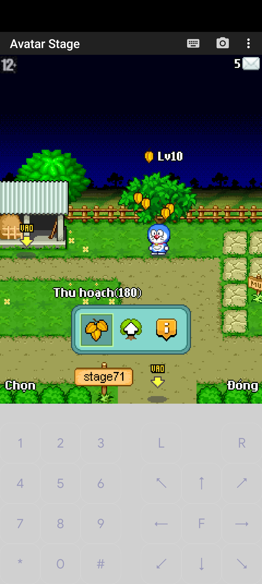
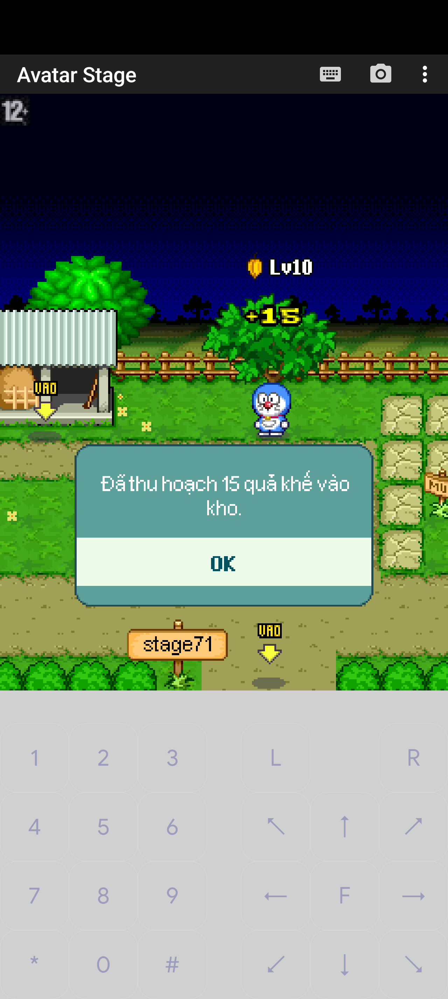

# Gameplay recovery report — 2026-10-28

## Milestone 2.2 — current status supersedes historical results

[Chắc chắn] Baseline `98d85d7` clean; **60 unique tests pass (33 unit +27 DB)** on Java17. Stale committed inventory/currency overwrite is guarded by persisted player/farm revisions and atomic logout; ambiguous commit/resource-close failures fail closed, rejected snapshots are retained privately. Duplicate login preserves the active owner. Additive schema applied only to isolated staging; mixed old/new writers are unsupported.

[Chắc chắn] Attendance remains **PARTIAL**: real client71 authenticated/rendered maps9/23/reconnected, but NPC850 map25/menu/claim was not reached. No reward/double-claim E2E evidence. Chat/friends/visits remain PARTIAL and downstream gates were not attempted. Native63 remains **PARTIAL, live BLOCKED/defaultOFF**: replay after replenishment is still reproduced. No load test or production cutover.

Current [report](MILESTONE_2_2_REPORT.md), [client evidence/manual procedure](MILESTONE_2_2_E2E_EVIDENCE.md), [stale-session root cause](STALE_SESSION_ROOT_CAUSE.md). Final JAR SHA256 `18df157280dc1ee2915a4a17442a6282c31d5eb3edbbbc385e119016c8d5750a`. Sections below are historical and do not supersede this result.

## Milestone 2.1 — kết quả thay thế trạng thái cũ

[Chắc chắn] Tiếp tục từ `79e939f48403feb054e6ce2ac509bf45d3b04929`, ban đầu worktree clean. Java 17 build đạt; **47 test khác nhau đạt: 32 unit + 15 DB opt-in**, không cộng rerun. JAR SHA256 `9ef00532c343e4dfd44db8aace5fcf67702b70e913a95f39c3150fedb8106008` trùng artifact chạy staging. Đã sửa boss/bot tự chiếm player TCP slots và null-zone khi client gửi context 8. Cùng MIDlet 71 reconnect được sau restart bản cuối, nhưng toàn bộ acceptance E2E vẫn **PARTIAL**.

[Chắc chắn] Test DB tái hiện replay sau harvest mới (100→240→380 xu) và stale snapshot khôi phục kho đã bán. Native 63 chỉ chứa product short, không có operation ID dùng để deduplicate bền vững. **Live sales BLOCKED, mặc định OFF**; không đổi packet layout, không có giá production. Commit ACK loss/precommit/rollback failure đã được fault-inject ở JDBC boundary trên DB cô lập; không phải crash hoặc client E2E test. Backup production **PARTIAL**, load gate chưa đạt, không cutover.

Bằng chứng và giới hạn hiện hành: [MILESTONE_2_1_FINAL_REPORT.md](MILESTONE_2_1_FINAL_REPORT.md), [CLIENT_CONNECTIVITY_DIAGNOSIS.md](CLIENT_CONNECTIVITY_DIAGNOSIS.md), [NATIVE63_REPLAY_ANALYSIS.md](NATIVE63_REPLAY_ANALYSIS.md). Các mục Milestone 1/2 bên dưới là lịch sử, không dùng để nâng trạng thái Milestone 2.1.

[Chắc chắn] Đã audit và triển khai một phần trong worktree cách ly `/Volumes/sontc/sources/others/avatar2d-gameplay-migration`, nhánh `codex/gameplay-migration`. **Chưa hoàn tất toàn bộ yêu cầu; chưa có nhóm gameplay mới đạt COMPLETE theo completion rule. Không cutover production.**

## Milestone 2 — kết quả hiện tại

[Chắc chắn] Tiếp tục từ SHA `4b81b289dcb7f9489cb1e6de8278dfaf8cae08b4`, worktree ban đầu clean. Đã thêm friend accept/list/delete persistence bằng bảng InnoDB canonical và native63 transaction kho–xu, defaultOFF theo local approved catalog; không có giá production. Đã kiểm lại30test cũ; tổng41test khác nhau đạt (31mặc định+10DB opt-in). Bản build Java17 đạt. Chi tiết wire, client, DB và giới hạn tại [MILESTONE_2_EVIDENCE.md](MILESTONE_2_EVIDENCE.md).

Hai Avatar2.5.8 client đã đăng nhập và cùng render trong khu vui chơi trên build trung gian. Chưa bắt được đầy đủ social/attendance/visit/sale flows; reconnect vẫn lỗi. **Các flow ưu tiên vẫn PARTIAL, Milestone2 chưa hoàn tất.** Native63 thiếu nonce nên replay sau lần thu hoạch mới chưa được giải quyết; live sales giữ OFF. Không load test khi functional gate chưa đạt.

Đã restore dump staging35bảng vào DB riêng, checksum players/farm_data khớp khi writer dừng. Production backup vẫn chưa có quyền thực hiện; xem [quy trình chờ admin duyệt và rollback](PRODUCTION_BACKUP_READINESS.md). Không migrate/deploy/restart production.

Các phần bên dưới giữ bằng chứng Milestone1 và đã hiệu chỉnh các chỗ bị thay thế bởi implementation Milestone2; số test/client harvest trong phần lịch sử không được tính là chứng minh flow mới.

## Baseline và quyết định

Original dirty master dựa trên `d8d5f26688465724d9955dc5045e9545a0dba91b` được giữ nguyên; local tracked/untracked project changes được bảo toàn tại baseline `be61e59` trong worktree mới, không lấy ignored secrets/logs/artifacts. Primary donor `970a9f9b30eb655943e455616b44bea3656d6166`, secondary `a30f3693756221c688f1350e748d7beb03470e41` được clone ngoài repo. Primary package build đạt trên Java17; chưa chạy donor runtime hoặc migrate dữ liệu người chơi sang donor.

Chọn selective implementation độc lập, không transplant donor classes/data. Xem [ma trận](GAMEPLAY_MIGRATION_MATRIX.md) (19 command farm, đủ28NPC, mọi nhóm nghiệp vụ), [quyết định kiến trúc](MIGRATION_ARCHITECTURE_DECISION.md) và [SQL/rollback](../database/migrations/README.md).

Không tìm thấy LICENSE/COPYING/NOTICE cấp quyền tại hai SHA đã kiểm tra; điều này chặn sao chép/deploy donor, không được hiểu là kết luận toàn bộ dự án không có bản quyền. Những hành vi compatible đã sửa dưới đây được viết tại owner target hiện có.

## Thay đổi đã triển khai — PARTIAL, có giới hạn

- Chat riêng -6: response dùng senderID xác thực thay ID1; offline receiver trả thông báo. Invite -21: int inviter, UTF name, UTF prompt đúng native client, guard self/offline. Milestone2 đã thêm accept/delete/list persistence; client E2E, privacy và inbox offline chưa đạt.
- Khế: hồi3/phút, tối đa180 trong60phút, dùng epoch millisecond lưu cùng row farm_data/kho; không scheduler mỗi player. Giữ legacy chưa hái, không refill vô điều kiện khi join. Harvest native85 short215/shortquantity; đồng bộ User, giới hạn kho, rollback RAM nếu DB fail. Đây là quy tắc local capacity180, không phải bảng nâng level donor.
- Thăm trại: encode đúng owner online hoặc snapshot offline, không lấy farm visitor rồi gắn ID người khác; load/save farm dùng chính User instance, không phụ thuộc session.user. Context invalidated trước lookup; visitor không được hái khế owner. Chưa hoàn thiện privacy/stealing/offline-client E2E.
- Điểm danh NPC850: vé593 +20score theo ngày Asia/Ho_Chi_Minh; một conditional SQL UPDATE ghi chests/scores/date cùng lúc, chống nhận lại/concurrency, không giữ reward nếu DB fail. Kiểm catalog vé/type, slot, quantity và overflow. Chưa có real-client click điểm danh; còn giả định single active writer/session của target.

Không coi các sửa trên là chứng minh transaction safety cho mọi inventory/currency writer legacy hoặc nhiều server cùng DB.

## Kiểm thử tự động — lịch sử Milestone1

Java17 Corretto17.0.18; Maven mặc định trên máy dùng JDK khác nên các lệnh được đặt JAVA_HOME rõ ràng.

- Baseline:21pass,1opt-in skip.
- Sau sửa: `mvn -q test` exit0:28pass,2opt-in DB skip.
- DB mới `avatar2d_starfruit_test` trên instance staging13317: FarmPersistenceTest + AttendancePersistenceTest exit0,2pass. Combined30tests,0failure/0error.
- Social3: handler→packet sender/invite và offline feedback. FarmVisit1: owner snapshot/khế và visitor bị chặn. Starfruit6: exact native85, replay, đồng thời, lỗi ghi, hồi30phút90, cap/future anchor và rollback regrowth. GameplayFeedback15/SessionLifecycle3 tiếp tục đạt.
- DB farm: additive columns lặp lại, inventory/clock reload trên User không session, chống duplicate và currency unchanged khi house insert cố ý fail. DB attendance: hai request một winner, User mới bị từ chối cùng ngày, SQL failure không giữ vé/ngày, ngày sau được nhận, ngày tương lai từ chối.

Evidence tối thiểu không chứa config/password nằm tại [automated-tests.txt](evidence/gameplay-20261028/automated-tests.txt). Không gọi unit packet capture là client E2E.

## Client thật và staging — lịch sử Milestone1

Game riêng loopback19129, MariaDB10.11 instance user-owned loopback13317, DB `avatar2d_gameplay_stage`; static tables từ target, tài khoản tổng hợp stage71, không copy user production. Resources staging hiện có được tham chiếu qua symlink. JAR được upload và hash đối chiếu: `2acd54325d55a403750d46aaa5ab2bb3ebf14e0c2cab7d96b4370e0393d57154` (formatting-only FarmService sau build không thay logic).

Client Avatar2.5.8 riêng tên AvatarStage trên J2ME Loader1.8.2, Android emulator. Chỉ patch host loopback/disable remote list bằng helper target; APK production không bị thay. Tunnel local19128→homelab19129, adb reverse; chọn Xứ Sở Thần Tiên/Bảo Bình. Login bằng account tổng hợp, city map, tới khu nông trại, vào FARM, đi tới cây, chọn Thu hoạch180.

[Chắc chắn] Server nhận farm context10, command61 và85; client render thông báo “Đã thu hoạch180 quả khế vào kho”, cây hết quả. DB lập tức có user71, quantity0, anchor1793123471752, nongsandacbiet `[{"id":215,"soluong":180}]`. Sau TERM đúng JVM staging và khởi động JVM mới, DB vẫn giữ nguyên clock/kho; sau khi khởi chạy lại MIDlet, client đăng nhập lại và vào farm, menu hiển thị12quả hồi; lúc gửi harvest qua ranh giới phút nhận15quả, DB kho tăng180→195 và anchor đổi1793123779887. Không chỉnh clock DB để tạo kết quả này.

Client reconnect ngay sau restart gặp “Kết nối thất bại”; khởi chạy mới MIDlet và chọn lại Bảo Bình đăng nhập thành công. Chưa kết luận nguyên nhân reconnect cũ. Vòng client mới→reload→elapsed regrowth→harvest sau restart đạt; sale và upgrade chưa đạt, nên nhóm khế vẫn PARTIAL. Command87/menu thông tin vẫn trả unsupported; Milestone2 đã thêm bán63 defaultOFF nhưng catalog production và client sale E2E vẫn thiếu. Attendance, social hai client, farm owner khác/offline, cooking/animals/upgrade/stealing, minigames, clans, auction và wedding chưa đạt client E2E.

## Tài nguyên và backup

[Chắc chắn] Quan sát staging một client, không phải benchmark10users: heap khoảng12–16MiB dùng/32MiB committed/128MiB max trong lần chạy đầu;65Java threads idle,67 với client. RSS khoảng102–104MiB;79–81OS threads. Các mẫu cuối processCPU tăng0.16s/10s≈1.6% một core (tải thấp, không suy ra sức chịu tải). DB Max_used_connections4, Threads_connected3 gồm observer; pool cấu hình max4/min1. IO cumulative sau~3phút read626688/write475136bytes, cache/HDD làm số này không đại diện cold start hoặc mức tải lâu dài. JVM sau restart có nhiều map/boss threads hơn; xem raw snapshot, chưa xác nhận không leak.

Các mẫu có PID/heap/CPU/IO và dispatch nằm trong [evidence](evidence/gameplay-20261028/). Chưa chạy10client/load-soak, chưa có latency percentile hoặc đo các workload homelab khác.

Staging đã dump trước từng DDL; pre-attendance restore thành công sang DB thứ ba `avatar2d_restore_check`,1synthetic player và clock column có mặt. Hash trong artifacts-backup.txt. Không coi đây là production backup. SSH user không đọc được deployment/backup root và không có sudo không tương tác; production không được backup, migrate hay restart. MainPID313665/NRestarts0 trong các snapshot. Không dùng các deploy scripts cũ có bước stop production.

## Các phần còn thiếu/chặn

1. **Economy/catalog:** target farmitems trống và khác schema donor; chưa có giá215, animal/recipe/support/capacity chuẩn đã được cấp quyền và kiểm chứng. Không seed bằng dữ liệu đoán. Milestone2 có transaction kho–tiền/overflow/rollback tests; replay sau nhập kho mới, uncertain-commit fault injection và client sale/restart còn chặn bật live.
2. **Protocol:** 19command farm nhiều request/response chưa chốt; các constant83/94/95/96/97/98 không chứng minh donor handler. Friend accept/list/delete đã triển khai native/custom-list theo client bundled nhưng chưa client E2E; NPC ID761/858/859/861 va chạm ý nghĩa. Cần xác minh riêng từng flow.
3. **State/data:** clan procedures chưa có migration/role tests; card games cần transplant model lớn hoặc implementation mới, full multi-client game và reward ledger; auction cần durable settlement/idempotency/offline awards; wedding cần consent và cả hai spouse persistent. Không bật từ menu/stub hoặc ID cứng.
4. **Runtime:** chưa xử lý reconnect tại cùng MIDlet đang mở, chưa chứng minh daily click, selling, đầy đủ crop/animal loop và game completion; chưa đủ10users/stability. Các test hiện tại không thay các bước này.
5. **Deployment:** không có verified production backup/restore và quyền cutover; giữ production nguyên trạng. Quyền source donor cũng chưa xác minh.

Các blocker trên là công việc còn lại, không phải yêu cầu đã hoàn thành. Hướng tiếp tục: chốt catalog/contract, xử lý từng flow theo priority trong ma trận, bổ sung tests và client evidence; chỉ sau đó xét cutover. Hướng dẫn vận hành thử nghiệm tại [scripts/staging](../scripts/staging/README.md).

## Trạng thái bàn giao Milestone1 — lịch sử

[Chắc chắn] Sau kiểm tra đã dừng đúng JVM staging và MariaDB instance thử nghiệm, đóng hai SSH tunnels13317/19128 và gỡ adb reverse; không để root bootstrap DB hoạt động. Data, private config, artifact và backup được giữ trong thư mục staging user-owned để xem lại. Snapshot cuối chỉ còn listener game production19128, MainPID313665/NRestarts0. Hash tracked diff checkout gốc vẫn bằng baseline patch `c31dac0e498aab840a22f09b499a101ec76b8fff66300b21bfde936f8c66ddbf`.

## Trạng thái bàn giao Milestone2

Implementation được giữ trong cùng migration branch; không mở branch/worktree mới. Các file evidence mới không chứa credential/dump production. Staging chỉ dùng synthetic users; trước bàn giao dừng đúng JVM/DB thử nghiệm và gỡ tunnel/reverse do phiên này tạo. Dữ liệu/backup private được giữ để tái kiểm. Không có feature mới COMPLETE/WORKING; kết quả kiểm chứng và blocker nằm trong MILESTONE_2_EVIDENCE.md.
