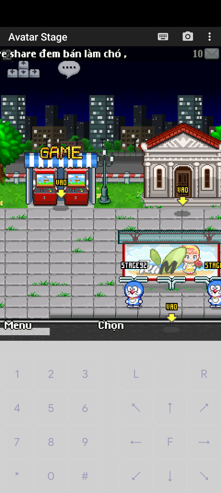
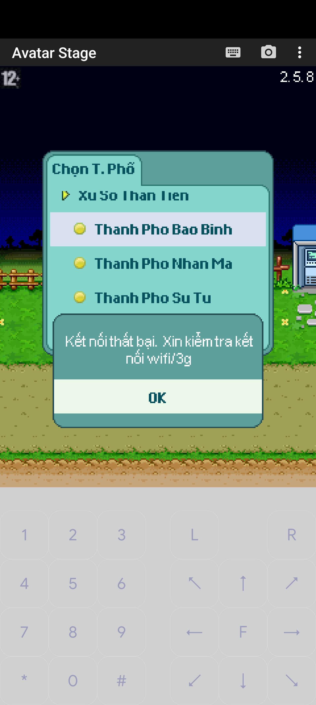

# Milestone 2 evidence — 2026-10-28

[Chắc chắn] **Milestone 2 chưa hoàn tất.** Có implementation và kiểm thử mới; chưa có flow ưu tiên nào đủ bằng chứng client/persistence để nâng lên WORKING. Không cutover, không thay production services/databases. Tài liệu phân biệt packet test, quan sát client và phần chưa thực hiện.

## Git và regression baseline

Tiếp tục worktree `/Volumes/sontc/sources/others/avatar2d-gameplay-migration`, đúng nhánh `codex/gameplay-migration`, SHA đầu phiên `4b81b289dcb7f9489cb1e6de8278dfaf8cae08b4`; trạng thái đầu phiên clean. Không reset/rebase migration. Checkout gốc `/Volumes/sontc/sources/others/avatar2d` được giữ riêng; tracked diff SHA256 ban đầu `c31dac0e498aab840a22f09b499a101ec76b8fff66300b21bfde936f8c66ddbf`. Không copy secrets/logs vào Git.

Đã đọc lại MIGRATION_REPORT, GAMEPLAY_MIGRATION_MATRIX, MIGRATION_ARCHITECTURE_DECISION và giữ hướng selective implementation tại owner hiện có, không transplant donor hay rewrite kiến trúc. Regression cũ28unit+2DB=30pass được chạy lại. Lần thử DB đầu chưa có tunnel nên thất bại kết nối; chạy lại sau khi khởi tạo instance/tunnel đạt2/2, không giấu lần thử này.

Build dùng Java17 Corretto17.0.18 qua JAVA_HOME rõ ràng. Test mới gồm sales defaultOFF, từ chối accept không có lời mời, trace incoming không tiêu thụ payload, 7salesDB và 1friendDB. Tổng **41test khác nhau đạt** qua các lần chạy riêng; package mặc định31pass/10opt-in skip, không cộng số lần rerun thành test mới. Xem [automated-tests.txt](evidence/milestone-2-20261028/automated-tests.txt).

## Môi trường và client thật

Game staging loopback19129, MariaDB10.11 riêng loopback13317, poolmax4/min1, DB `avatar2d_gameplay_stage`, static target + synthetic stage71/92. Không dùng schema/player production. Private config thực tế là `config.properties` và `database.properties`; resources symlink staging chỉ đọc. JAR đã chạy staging SHA256 `a39360149756a77c83172055c4bc68996d8e2ee41422215a44c31ce7c073f860` khớp local/remote; sale catalog không được bật. Sau đó bổ sung guard đóng session khi rollback thất bại trong nhánh validation; artifact cuối `bc2c05dc4ee6085fbbba1c35b033297a7c4beb8bf1bcb873f168aa3e4fa8def7` build/test đạt nhưng chưa chạy lại trên staging.

Hai MIDlet Avatar2.5.8 trên J2ME Loader1.8.2, Android emulator5554 và AVD riêng5556. Client staging chỉ patch host127.0.0.1/disable remote server list; không thay APK production. SSH tunnel19128→staging19129 và adb reverse. Hai tài khoản đã đăng nhập và cùng xuất hiện ở khu vui chơi trên bản build trung gian. Screenshot dưới chỉ chứng minh render hai nhân vật, không chứng minh gửi chat/kết bạn. Nhãn người thứ hai bị mép viewport cắt.

Có các lần ADB device offline/server5037 bị khởi động lại, reverse phải thiết lập lại; dùng server5038 riêng vẫn chưa có phiên ổn định đủ để chốt E2E. Chưa xác định lỗi nằm ở ADB/tunnel, cached MIDlet, server hay tổ hợp. Cache staging cũ trên5554 được đổi tên giữ lại `Avatar Stage-m2-preserved`, không xóa dữ liệu app khác. Khởi chạy MIDlet mới từng đăng nhập thành công; reconnect cùng MIDlet sau restart chưa đạt. Trên JAR cuối, server nhận connection/context9 nhưng chưa có authenticated gameplay packet của71/92. Không lấy screenshot cũ làm chứng minh JAR cuối.

## Đối chiếu từng flow ưu tiên

I=int32, S=int16, B=byte, Z=boolean, UTF=Java modified UTF. Wire dưới được đối chiếu bundled client bằng javap; không commit disassembly hay client JAR. Cột chưa đạt là công việc còn lại, không phải pass.

| Flow / trạng thái | Request → response đã xác minh cấu trúc | Bằng chứng server/DB/test | Client/persistence còn thiếu |
|---|---|---|---|
| Private chat PARTIAL | -6: I receiver,UTF content → I authenticated sender,UTF sender name,UTF content | Handler test sender71→receiver92 đúng ID/name; offline feedback. Trace thực tế chỉ thấy Admin(-6,id1) lúc login; **không phải private chat giữa2người** | Chưa bắt được request -6 từ71/92 và client người nhận render đúng sender |
| Bạn bè PARTIAL | -21:I target → I inviter,UTF name,UTF prompt; -19:I inviter,Z accept → I other,UTF name,Z result,UTF text; -18:rỗng → -81 custom list; -81:I listId,B action,S index,B page | Pending invitation5phút/max32, chống unsolicited accept; canonical row(71,92), reload service/list rồi delete đạt DB test. Migration InnoDB riêng; staging thực tế friendships=0 | Chưa invite/accept/delete/list bằng client thật; chưa restart JVM với friendship thực tế. List giới hạn100/chưa pagination; native-20 chưa triển khai |
| NPC850 attendance PARTIAL | -61:I(2000000850); menu -59:I target,B menu,B selection; server dialog | Regression DB:1winner/concurrency, 593+20score cùng UPDATE, reload chống doubleclaim và rollback lỗi. Staging71/92 scores0,attendanceNULL | Chưa client bấm NPC850, chưa nhận vé rồi restart/login/claim lần2. DB còn NULL nên không được ghi nhận client pass |
| Visit farm online/offline PARTIAL | Context -1:B10; 61:I owner → owner/land/animal/starfruit snapshot | Online packet test và snapshot load cũ đạt; shared Session FarmService giữ viewed-owner context khi friend visit. Visitor harvest bị chặn | Chưa client vào farm người khác cả online/offline, chưa đầy đủ persistence/privacy proof |
| Reconnect PARTIAL | Handshake -27, context -1, login theo client native; farm61/85 khi quay lại | Baseline native handshake tests đạt. JVM staging đã TERM/restart đúng PID; kho71 vẫn195,anchor1793123779887 | Cùng MIDlet báo kết nối thất bại; fresh-login trước đó không thay cho reconnect flow. Nguyên nhân UNVERIFIED |
| Starfruit/product sale PARTIAL | Farm63:S product → I earned,I balance,S product | 7DB tests + defaultOFF unit; item215 được hỗ trợ. Chi tiết transaction bên dưới | Chưa native63 từ client thật, chưa sale→JVM restart→login đọc lại xu/kho; giá production chưa được duyệt |

Native custom-list -81 response: UTF key=`friendlist`,UTF title,I listId,B avatarType1,B page1,S count; mỗi entry B appearanceCount0,I id,S icon-1,S wedding-1,S status-1,UTF name,UTF Online/Offline; B menuCount2 rồi cặp B action,UTF label. Action1 xóa,2 thăm trại. -18 trong FarmMsgHandler vẫn là context-specific steal stub, không bị route chung ghi đè.

## Native63: phạm vi đã kiểm chứng và giới hạn

Mặc định OFF. File local chỉ được bật khi enabled=true, approval không rỗng và item có giá nguyên dương. Template không có giá. Người vận hành phải giữ phê duyệt economy ngoài repo; chuỗi approval không tự chứng minh một giá đã được duyệt. Synthetic fixtures dùng215=7xu,7=2xu **chỉ test**, không production catalog.

Transaction khóa players rồi farm_data bằng FOR UPDATE, đối chiếu ownership/quantity và số dư RAM–DB, ghi JSON quantity0 và xu cùng commit. Chỉ column được whitelist theo loại item; từ chối JSON hỏng/fractional/duplicate selected product, stock thiếu, giá thiếu/không hợp lệ, packet sai độ dài và overflow phép nhân/cộng/giới hạn int32 response. RAM cập nhật sau commit; rollback khi DB fail. Mất xác nhận commit hoặc rollback failure đặt cờ uncertain, chặn save snapshot cũ và yêu cầu reconnect. **Chưa fault-inject mất ACK commit, mất điện hoặc lỗi rollback**; không tuyên bố crash safety toàn hệ thống.

7DB tests: success earned140/balance240/stock0, replay trên User reload;10request/5workers cùngUser chỉ credit1lần;2User stale tranh cùngrow chỉ1winner; SQL CHECK reject money sau bước trừ kho rollback cả2và RAM; unowned/missing price/int overflow không đổi state; quantity20.5 bị từ chối; normalproduct7quantity3price2 chỉ bán kho7, giữ nguyên khế20. FriendDB test dùng DB khác với gameplay, tạo/đọc/xóa1mutualrow.

**Replay còn giới hạn:** native63 chỉ có itemID, không có transaction nonce. Duplicate trước lần nhập kho tiếp theo bị chặn; packet cũ sau harvest mới không phân biệt được với sale mới. Không bịa thêm field vào protocol. Live sales phải tiếp tục OFF cho đến khi có cơ chế đã xác minh đáp ứng yêu cầu replay này, client E2E và giá phê duyệt. Writer legacy khác vẫn cần giả định single active session/JVM; transaction riêng không biến mọi economy writer thành atomic. Chưa thử multi-JVM hoặc logout stale từ session khác.

## Logs, DB, restore và load gate

Trace staging opt-in mặc địnhfalse; chỉ selectedcommands sau auth, có thể chứa chat nên private. QUEUED chỉ là xếp hàng gửi. Trace bản thử đầu đọc getData trên incoming Message cho bytes0: các dòng RECV đó **không chứng minh payload rỗng**. Bản cuối lấy byte[] trực tiếp sau giải mã; socket test xác minh trace `cmd=-61 bytes=4 hex=0000005c` và handler vẫn đọc được target92. Đây là test transport, không client authenticated gameplay.

DB snapshot cuối trước restart bản cuối:71/92 xu20000,scores0,attendanceNULL;farm71special215=195,quantity0,anchor1793123779887;farm92special[],quantity180,anchor0;friendships0. Giữ các giá trị này làm negative evidence rằng sale/attendance/friendship chưa diễn ra trên staging, không lấy DB fixture làm dữ liệu client thật.

Restore quiesced staging đã đạt35tables và checksum core khớp; xem [PRODUCTION_BACKUP_READINESS.md](PRODUCTION_BACKUP_READINESS.md). Production vẫnMainPID313665/NRestarts0; không có quyền backup production nên cung cấp procedure chờ admin duyệt, không vượt quyền.

**Không chạy load test1/3/5/10** vì functional/client gate chưa qua. Không tạo LOAD_TEST_REPORT.md và không diễn giải bot connections/TCP sockets thành active authenticated game players. Probe có mẫu heap/thread/CPU tình cờ khi thao tác, không có latency percentile, disconnect rate hay baseline tác động các service homelab khác; không dùng để kết luận capacity.

## Công việc bắt buộc còn lại

Ổn định/capture đường truyền client→staging, chạy lại cả5flow với packet+UI+DB trước/sau restart; fault-inject sale uncertain-commit, giải quyết replay sau replenishment theo protocol đã kiểm chứng; phê duyệt catalog; administrator backup/restore production; chỉ sau functional pass mới chạy load1/3/5/10 bằng client thực sự login và hoạt động. Mọi mục thiếu vẫn PARTIAL/UNVERIFIED, không có COMPLETE mới.

## Dọn môi trường và bảo toàn cuối phiên

[Chắc chắn] Đã TERM JVM staging323771 sau kiểm cwd, shutdown instance MariaDB riêng321405 qua socket private; đóng đúng SSH tunnels36580/38510, gỡ reverse19128 và dừng emulator5556 riêng/ADB5038 do phiên này tạo. Emulator5554 và APK production được giữ. Không xóa DB/dump/config staging; AVD tạm và cache cũ được giữ ngoài Git. Listener cuối chỉ còn production19128 trong ba port được kiểm; service MainPID313665/NRestarts0. Tracked diff checkout gốc vẫn có SHA256 `c31dac0e498aab840a22f09b499a101ec76b8fff66300b21bfde936f8c66ddbf`.
